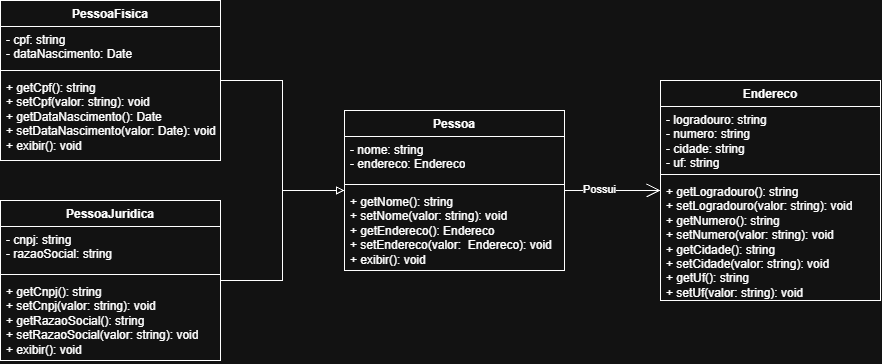

# Cadastro de Clientes - Appfull / Electronic

**Aluno:** Nathan Paiva Franco
**Curso / Unidade Curricular:** Desenvolvimento Mobile Flutter / POO
**Data:**  14/11/2026

## Sobre o projeto
Módulo de cadastro de clientes (pessoas físicas e jurídicas) de um aplicativo de e-commerce, feito em JavaScript orientado a objetos. O projeto usa herança, encapsulamento (campos privados, getters e setters) e tratamento de erros com `throw`, `try` e `catch`.

## Diagrama de classes


O arquivo editável está em `diagrama-classes.drawio`.

## Estrutura do projeto
- `Endereco.js`: logradouro, número, cidade e UF
- `Pessoa.js`: classe base (nome e endereço)
- `PessoaFisica.js`: herda de Pessoa (CPF e data de nascimento)
- `PessoaJuridica.js`: herda de Pessoa (CNPJ e razão social)
- `index.js`: cria os clientes e executa os testes

## Como executar
Com o Node.js instalado, abra o terminal na pasta do projeto e rode:

```
node index.js
```

## Regras de validação
- Nome com ao menos 3 caracteres
- CPF com 11 dígitos e CNPJ com 14 dígitos (pontos, traço e barra são ignorados)
- Data de nascimento válida e que não esteja no futuro
- Razão social obrigatória

## Evidências de teste

Cenários executados:
1. Pessoa física válida
2. Pessoa jurídica válida
3. Pessoa física inválida (CPF incompleto)
4. Pessoa jurídica inválida (razão social vazia)

Saída do terminal:

```
=== Cenário 1: Pessoa física válida ===
Cadastro realizado com sucesso.

=== Cenário 2: Pessoa jurídica válida ===
Cadastro realizado com sucesso.

=== Cenário 3: Pessoa física inválida (CPF incompleto) ===
Erro no cadastro: CPF deve ter 11 dígitos.

=== Cenário 4: Pessoa jurídica inválida (razão social vazia) ===
Erro no cadastro: Razão social é obrigatória.

=== Clientes cadastrados (somente válidos) ===
Nome: Maria Silva
Endereço: Rua das Flores, 123 - Bragança Paulista/SP
CPF: 12345678909
Nascimento: 20/05/2000
---
Nome: Tech Peças
Endereço: Av. Brasil, 500 - Campinas/SP
CNPJ: 12345678000190
Razão social: Tech Peças Ltda
---
Total de clientes válidos: 2
```